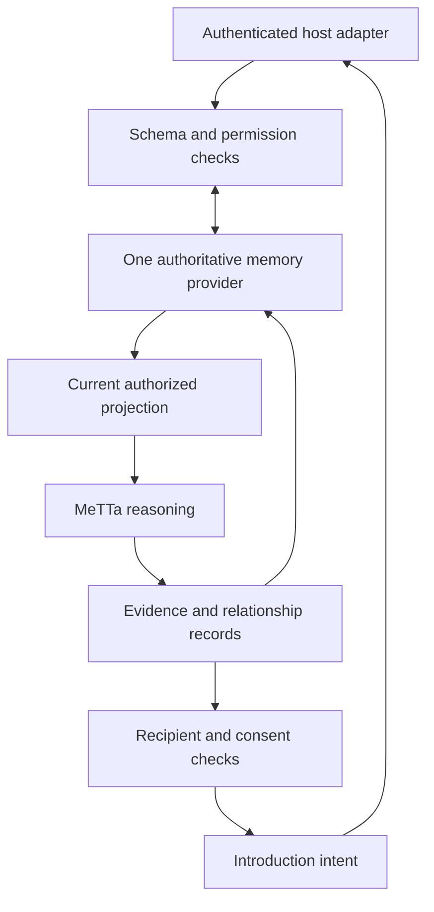

# Architecture and permissioned temporal memory

## Boundaries

`Utsa` receives one `MemoryPort`. The local SQLite adapter stores contribution
revisions, permission changes, pause state, inferred relationships, and acceptance
decisions in the same file. MeTTa's per-call AtomSpace is an ephemeral projection,
not another authoritative store. Raw text is not copied into relation rows.

When a supported Hives memory provider is verified, replace the injected provider.
Do not instantiate SQLite alongside Hives as a second authoritative record store.
If the host cannot provide the required semantics, explicitly agree a designated
authority and a migration before integration. No automatic dual-write mode exists.

## Shared contribution schema

The schema supports people, agents, projects, ideas, knowledge, and resources.
Every contribution has an accountable owner, typed entity, stable namespaced ID,
origin container and source reference, immutable source creation time, revision,
original wording, permitted summary, domain, explicit interests, capability or
requirement, evidence status, concrete action, validity, freshness, availability,
capacity, and supported conditions. Availability is an explicit assertion, never
inferred from an interest or history.

V1 accepts one required capability per atomic need. Split a complex need into
records; do not treat satisfying one requirement as fulfilling an entire project.
Supported conditions are remote/onsite/either, volunteer/paid/either, and an
explicit unresolved-condition list. Any unresolved condition prevents an
opportunity. Rate negotiation, locations, arbitrary contracts, calendars, and
multi-party exchanges require later schema and rule work.

IDs are stable identifiers, not a promise of anonymity. The host must establish
identity equivalence and delegated authority; matching names or hashing handles
cannot do that. A project or agent owner is accountable for the assertion, and
this core cannot execute work on its behalf.

## Permission checks

Permissions are separate trusted writes, never fields inferred from a message.
The default is deny. A grant specifies the exact record revision, principal,
destination container, purpose, action, expiry, and allowed/revoked state.

- `discover`: allows the matching agent to use that record in that destination.
  Both records need an applicable grant, even if they originated publicly.
- `preview`: separately permits one recipient to see the approved summary and
  the bounded explanation. Both source summaries require grants to that recipient.
- An introduction decision belongs to an authenticated source owner and is tied
  to a relation ID containing the exact revisions and reasoning configuration.
  Silence, one acceptance, and the operator's permission cannot substitute for
  both owners' choices.

The internal discovery API returns source IDs and evidence to the trusted host
adapter. It is **not** a participant response. The participant-facing `preview`
omits counterpart IDs, raw quotes, provenance URLs, and private decisions. It
returns only a separately approved summary. A summary is not automatically
de-identified: the owner/host must review it before granting preview access.

An introduction intent is always `delivered: false`. It still requires host
identity resolution, explicit grants for the contact fields to disclose, a final
authorization check at the actual delivery boundary, and a receipt. No public
fallback or automatic contact disclosure exists. This prototype does not send
messages, attest outcomes, assign reputation, or execute agents.

## Temporal semantics

- `created_at`: immutable source-event time, with origin provenance.
- `recorded_at`: when the authority recorded a revision or policy event.
- `[valid_from, valid_until)`: contribution validity interval.
- `fresh_until`: when re-confirmation is required; there is no silent extension.
- Availability uses a separate half-open interval and declared hours.
- Relationship records retain detection time, supporting IDs/revisions, rule hash,
  domain-mapping evidence/hash, destination/purpose, claim type, and limitations.

The latest revision is authoritative. Permission to revision 1 does not silently
carry to revision 2. Withdrawn, expired, stale, paused, or unauthorized records
are excluded before any inference, including shared-interest discovery. Expired
availability can leave a capability relationship but cannot produce an actionable
opportunity. Permission changes and both acceptance decisions are durable.

Persisted relationship rows are historical observations. Every preview and action
re-evaluates the current records and grants. Stored metadata or a cached result is
never delivery authority. Operational calls require a monotonic UTC clock; a
caller cannot move time backwards to reopen revoked history. These are temporal
records with a revision/event ledger, not a general bitemporal query language.

SQLite operations use a transaction spanning discovery, validation, and recording
an intent. A future distributed host adapter must preserve that consistency or
provide version-checked writes and fail closed. It must also handle revocation
between intent creation and external delivery.

Pause stops matching without deleting history. Local deletion removes all source
revisions and grants plus dependent relationship and decision rows. Backup/media
erasure and downstream copies are outside this local adapter and require host
support; the method does not claim forensic erasure.

## Executable rules and runtime

MeTTa implements shared-interest, complementary-capability, opportunity, blocker,
and bilateral-ready inference. Python supplies validated numeric and opaque
symbol facts, deterministic IDs, permission filtering, and persistence. There is
no Python fallback matcher. Arbitrary contribution text is never evaluated or
included as source code. Configured domain bridges are trusted, versioned code
inputs; imported documents cannot add bridge rules.

These are deterministic symbolic rules. They do not implement probabilistic PLN
scoring, learned mappings, autonomous paper ingestion, or LLM fallback. Those
features should be added only with their own evidence and regression tests.

## Reference implementation limits

The local API assumes its embedding application constructs authenticated `Actor`
and `Scope` objects. It is not an exposed multi-user server, identity provider, or
security sandbox. Anyone with direct database or process access can bypass its
application policy. Do not expose the demo CLI as a live service. Cross-container
fixtures use logical namespaces and separate processes, not an existing deployed
cross-workspace permission system. The implementation favors auditable small
examples over indexed large-scale matching, distributed operation, or load tuning.
